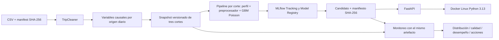

# MiBici Demand — Equipo 07

Predicción de viajes iniciados por **estación y hora** para planear redistribución de bicicletas. Se emite diariamente a las 00:00 locales para las siguientes 24 horas. Proyecto académico de MLOps con datos abiertos mensuales; no acredita operación en tiempo real ni aprobación productiva.

Repositorio: [Abyblackmouth/mibici-demand](https://github.com/Abyblackmouth/mibici-demand). Rama de la entrega: `fase3`.

## Indice

- [Modelo común](#modelo-comun)
- [Arquitectura](#arquitectura)
- [Instalación](#instalacion)
- [Artefactos recuperables](#artefactos-recuperables)
- [Datos y entrenamiento](#datos-y-entrenamiento)
- [Reproducción en entornos limpios](#reproduccion-en-entornos-limpios)
- [MLflow](#mlflow)
- [FastAPI](#fastapi)
- [Docker](#docker)
- [Monitoreo](#monitoreo)
- [Pruebas y calidad](#pruebas-y-calidad)
- [Resultados y limitaciones](#resultados-y-limitaciones)
- [Rúbrica, roles y publicación](#rubrica-roles-y-publicacion)

## Modelo comun

[model_release.json](references/model_release.json) identifica `mibici-temporal-20260921-v1`: copia exacta del pipeline causal del 21 de septiembre, sin nuevo ajuste ni búsqueda. API, imagen predeterminada y monitoreo integrado comparten SHA-256:

```text
e355fb092ca5c6d3f8498369001a803c9afc399b82bdd379ee61b902809af372
```

Se tomó el último corte por cronología, **sin ordenar por métricas de evaluación conocidas**. Es el candidato técnico común; **no está aprobado para producción** ni se eligió mediante una nueva prueba ciega. El extremo del primer corte y la falta de un holdout nuevo certificado impiden acreditar robustez general. Octubre no se usa para seleccionar ni ajustar.

`models/best_pipeline.joblib` conserva el campeón **histórico** de Fase 2 y la integración anterior. No se reemplaza ni se presenta como validado prospectivamente. Los reportes antiguos conservan los modelos/versiones ejecutados entonces; la auditoría final describe la integración actual.

## Arquitectura



ML Canvas y destinatarios: [planteamiento del problema](references/planteamiento_del_problema.md). Estructura Cookiecutter: `mibici_demand/`, `tests/`, `data/`, `models/`, `notebooks/`, `reports/`, `references/`, `docs/`.

## Instalacion

PowerShell de VS Code, en la raíz. Para un **clon nuevo**, crear el entorno; no recrearlo si ya existe:

```powershell
py -3.13 -m venv .venv
& .\.venv\Scripts\python.exe -m pip install pip==26.3
& .\.venv\Scripts\python.exe -m pip install -r requirements-win-py313.txt
& .\.venv\Scripts\python.exe -m pip check
```

Se verificó Python **3.13.0** Windows x86-64 y Linux amd64. `requirements-win-py313.txt` fija el entorno completo; `requirements-linux-py313.txt`, el cierre de inferencia Linux. `requirements.txt` se conserva como lista funcional del desarrollo histórico, no como lock. El backend está fijado en `pyproject.toml`. No se cambia Python global.

## Artefactos recuperables

Git contiene código, manifiestos y evidencias ligeras. [artifact_bundle.json](references/artifact_bundle.json) fija versión, tamaños y SHA-256 de un ZIP preparado **localmente**; su URL está vacía hasta publicar con autorización. Un clon sin el paquete no puede servir ni ejecutar las integraciones que requieren modelos.

Obtener el ZIP autorizado del equipo y colocarlo en `artifacts/mibici-fase3-v1.zip`:

```powershell
& .\.venv\Scripts\python.exe scripts/artifacts.py restore .\artifacts\mibici-fase3-v1.zip
```

La restauración verifica ZIP y miembros, evita salidas de directorio y no sobrescribe versiones diferentes. Para preparar el paquete local sin subirlo:

```powershell
& .\.venv\Scripts\python.exe scripts/artifacts.py pack
```

Incluye campeón histórico, tres modelos temporales, candidato común, datos preparados causales y seis parquets del snapshot. No contiene credenciales, bases MLflow ni todos los años crudos. Los CSV de agosto/septiembre pueden recuperarse por las URLs/hashes de `data/raw/manifest.csv` para repetir desde crudo.

## Datos y entrenamiento

Se reutilizan `dataset.download/read_trips`, `TripCleaner`, `features.monthly_tables` y `temporal.build_fold`. Reglas y esquema: [hallazgos](references/hallazgos_de_datos.md), [diccionario](references/diccionario_datos.md).

Fase 3 utiliza solo agosto/septiembre de 2026. Divide por timestamps completos; cohorte y horario dependen del pasado. Cada rezago de 24/168 h cuenta viajes terminados antes del origen y de una hora cerrada. No usa lag_1, medias del día objetivo ni catálogo actual para evaluar el pasado. Entrena 28 días con 24 h de maduración; perfil/PCA, imputador, escalador y codificadores se ajustan solo con train.

El candidato conserva estación `int64`, calendario `int8`, rezagos `float32` y predicciones `float64`. No necesita coordenadas ni capacidad. La capacidad opcional de la API sirve solo como diagnóstico y nunca recorta salidas.

Para repetir el pipeline causal completo desde los dos CSV locales:

```powershell
& .\.venv\Scripts\python.exe -m mibici_demand.modeling.backtest --sin-descarga --threads 4
```

Omitir `--sin-descarga` si faltan. Las nuevas ejecuciones tienen directorios únicos en `reports/fase3/ejecuciones/`, `data/processed/fase3/ejecuciones/` y `models/fase3/`; no reescriben la evidencia congelada. Los cortes originales son 7, 14 y 21 de septiembre, con siete días posteriores cada uno; se emiten pronósticos diarios a 24 h.

Los comandos heredados siguen disponibles:

```powershell
& .\.venv\Scripts\python.exe -m mibici_demand.cli descargar --desde 2026-08 --hasta 2026-09
& .\.venv\Scripts\python.exe -m mibici_demand.cli procesar --desde 2026-08 --hasta 2026-09
& .\.venv\Scripts\python.exe -m mibici_demand.cli construir --desde 2026-08 --hasta 2026-09 --etiqueta replica
& .\.venv\Scripts\python.exe -m mibici_demand.cli registrar --version replica --etiqueta replica
& .\.venv\Scripts\python.exe -m mibici_demand.cli entrenar --etiqueta replica --max-train-months 6 --n-iter 5 --registrar-mlflow
```

`cli entrenar` guarda nuevos modelos/reportes en `ejecuciones/<id>`. El tuning legado ahora divide por horas completas y purga 24 h; se corrigió su antiguo TimeSeriesSplit por filas. Esto no reevalúa el campeón antiguo ni certifica disponibilidad causal de su tabla histórica. La integración final utiliza el procedimiento de Fase 3. No se acredita reproducción exacta de la búsqueda histórica de Fase 2: falta su snapshot de seis meses.

## Reproduccion en entornos limpios

[data_snapshot.json](references/data_snapshot.json) fija cortes, tipos, parámetros, semillas, fuentes y hashes. Reproducir **sí ajusta de nuevo** tres pipelines; guarda copias aisladas sin promoverlas:

```powershell
& .\.venv\Scripts\python.exe -m mibici_demand.reproduce --output .venv/reproduccion-local
```

Entorno Windows limpio adicional, dentro de este repositorio:

```powershell
& .\.venv\Scripts\python.exe -m venv .venv/repro-clean
& .\.venv\repro-clean\Scripts\python.exe -m pip install --no-deps -r requirements-repro-win-py313.txt
& .\.venv\repro-clean\Scripts\python.exe -m pip install --no-deps --no-build-isolation -e .
& .\.venv\repro-clean\Scripts\python.exe -m pip check
& .\.venv\repro-clean\Scripts\python.exe -m mibici_demand.reproduce --output .venv/reproduccion-windows
```

Linux limpio, sin volúmenes ni entorno virtual de Windows:

```powershell
docker build --platform linux/amd64 -f Dockerfile.train -t mibici-demand:repro-fase3 .
docker run --name mibici-reproduccion mibici-demand:repro-fase3
docker cp mibici-reproduccion:/tmp/reproduction .venv/reproduccion-linux
docker rm mibici-reproduccion
```

Tolerancias predeclaradas de métricas: 1e-6 absoluta/relativa. Datos/tipos deben coincidir exactamente; la tolerancia no permite omitir extremos. En la ejecución real las cuatro métricas coincidieron en los tres cortes; máximo error de predicciones Windows 0, Linux ≈3,6e-15. Los binarios reserializados pueden tener hashes distintos sin cambiar esas métricas. Esta verificación de entrenamiento es diferente de cargar el mismo binario en otro sistema.

## MLflow

Se registra en una base nueva, sin modificar el alias histórico `champion`:

```powershell
& .\.venv\Scripts\python.exe scripts/register_release.py
& .\.venv\Scripts\python.exe -m mlflow ui --backend-store-uri sqlite:///mlflow_integracion.db
```

Registro `mibici-fase3-candidato`, alias **candidate**. [mlflow_release.json](reports/fase3/integracion/mlflow_release.json) enlaza origen, nuevo registro y joblib exacto recuperado por SHA-256. MLflow incluye además una envoltura CloudPickle; sus bytes no son los del joblib. La base anterior `mlflow_fase3.db` conserva los cortes. API/Docker no necesitan MLflow.

## FastAPI

```powershell
$env:MODEL_PATH = (Resolve-Path .\models\final\pipeline.joblib).Path
$env:MODEL_SHA256 = (Get-Content .\references\model_release.json -Raw | ConvertFrom-Json).sha256
& .\.venv\Scripts\python.exe -m uvicorn mibici_demand.api:app --host 127.0.0.1 --port 8000
```

Abrir **http://127.0.0.1:8000/docs** y probar `POST /predict` con [predict_request_final.json](examples/predict_request_final.json). `/health` declara disponibilidad, hash, tipos, uso y corte mínimo. Carga una vez por proceso. El calendario se deriva del timestamp; el productor de variables construye los rezagos antes de emitir. Se rechazan origen anterior al corte, calendario manual y entradas inválidas con 422.

Otra terminal:

```powershell
Invoke-RestMethod http://127.0.0.1:8000/health
$body = Get-Content .\examples\predict_request_final.json -Raw
Invoke-RestMethod -Method Post -Uri http://127.0.0.1:8000/predict -ContentType application/json -Body $body | ConvertTo-Json -Depth 12
```

Respuesta ejecutada: [predict_response_final.json](examples/predict_response_final.json). Los ejemplos sin sufijo `_final` conservan la integración histórica. Para probar ese artefacto, cambiar MODEL_PATH y MODEL_SHA256 a sus valores históricos; no enviar una petición del 12 de septiembre al candidato entrenado después.

## Docker

Docker Desktop en modo Linux:

```powershell
docker desktop start
docker build --platform linux/amd64 --progress plain -t mibici-demand:fase3 .
docker run --rm --name mibici-fase3 --read-only -p 127.0.0.1:8000:8000 mibici-demand:fase3
```

La imagen incluye candidato/manifiesto, Python 3.13.0 fijado por digest y paquetes fijados. Sirve el puerto 8000 como usuario 10001, sin volúmenes, `.venv`, datos, credenciales ni MLflow. Si 8000 está ocupado, usar `-p 127.0.0.1:8001:8000`.

Para conservar también las diez integraciones históricas, construir su imagen separada:

```powershell
docker build --platform linux/amd64 --build-arg MODEL_SOURCE=models/best_pipeline.joblib --build-arg MODEL_FILENAME=best_pipeline.joblib --build-arg MODEL_DIGEST=0faf37a57e05346ebfd59e695320a1e33eb5cecea98f1aec46858992319ff6b2 -t mibici-demand:fase3-historico .
& .\.venv\Scripts\python.exe scripts/verify_final.py
```

El verificador compara Python directo, HTTP Windows, HTTP Linux e inferencia dentro del contenedor y detiene solo sus propios procesos/contenedores. No publica la imagen. DockerHub es un requisito académico **pendiente de autorización y ejecución**.

## Monitoreo

El experimento original del 7 de septiembre, sus diez escenarios y plan permanecen intactos en `reports/fase3/drift/`. El integrado usa el mismo SHA-256 de API/Docker y la semana del 21–27:

```powershell
& .\.venv\Scripts\python.exe -m mibici_demand.monitoring.drift --plan references/plan_drift_final.json --modelo models/final/pipeline.joblib --salida reports/fase3/integracion/drift_final --threads 4
```

Se conservan los umbrales: PSI 0,10/0,25; faltantes 1%/5%; desempeño +10% y mínimos absolutos, o caída R² ≥0,10. Control, composición pico, faltantes y combinación se evalúan al 10/30/50%. Etiquetas y registros se mantienen juntos; no hay reentrenamiento automático. WAPE puede mejorar al cambiar la mezcla mientras MAE empeora. PSI alto por cambio de mes no prueba fallo; los umbrales son ilustrativos.

Los faltantes se prueban **directamente en el pipeline** y su imputador; la API los rechaza con 422. Resultados/gráficos: [drift original](reports/fase3/validacion_drift.md), [drift del candidato](reports/fase3/integracion/validacion_drift.md).

## Pruebas y calidad

Restaurar artefactos y construir ambas imágenes. Las integraciones omitidas no cuentan como éxito.

```powershell
& .\.venv\Scripts\python.exe -m pytest tests -q --basetemp .venv/pytest-final --junitxml=reports/fase3/integracion/pytest_final.xml
$pythonSources = @(Get-ChildItem mibici_demand,scripts,tests -Recurse -Filter *.py | Where-Object { $_.FullName -notmatch '__pycache__' } | ForEach-Object { $_.FullName })
& .\.venv\Scripts\python.exe -m ruff check @pythonSources
& .\.venv\Scripts\python.exe -m ruff format --check @pythonSources
& .\.venv\Scripts\python.exe -m pip check
```

La [auditoría final](reports/fase3/auditoria_integracion_final.md) contiene la cifra ejecutada y evidencia JUnit; los reportes anteriores se conservan por separado.

## Resultados y limitaciones

- Fase 2: [partición y resultados históricos](references/resultados_fase2.md), [métricas](reports/resultados_modelos.csv), [registro](reports/resumen_mlflow_registry.md).
- Fase 3: [validación temporal](reports/fase3/validacion_temporal.md), [auditoría del extremo](reports/fase3/auditoria_backtesting.md), [API histórica](reports/fase3/validacion_api.md), [Docker histórico](reports/fase3/validacion_docker.md), [drift original](reports/fase3/validacion_drift.md).
- Se conserva RMSE 3,8942 y R² −1,3431 del primer corte, con predicción 438,0117 de estación 46. No se recortan extremos ni se cambian tipos para favorecer métricas.
- Los 28 días reducen descarga/cómputo; no se demostró suficiencia ni superioridad frente a seis meses. No se elige una ventana retrospectivamente usando evaluaciones.
- CSV mensuales simulan disponibilidad diaria; falta un feed operativo. Octubre no se consume, pero no se certifica holdout virgen por el mes 10 aprendido en el histórico.
- El candidato es técnicamente portable y reproducible sobre snapshots; no acredita mejora real de redistribución ni aprobación productiva.

## Rubrica roles y publicacion

[Rúbrica transcrita](references/rubrica_entrega_final.md), [matriz](reports/fase3/matriz_rubrica_final.md), [checklist](reports/fase3/checklist_prepublicacion.md), [propuesta de PR](references/PR_FASE3.md).

Roles funcionales y contribuciones comprobables: [roles y evidencias](reports/fase3/integracion/roles_evidencias.md). El equipo debe validar asignaciones y redactar su reflexión; no se atribuye el trabajo nuevo a personas sin prueba.

La lista exacta elegible está en `reports/fase3/integracion/archivos_github.txt`. Modelos, snapshots y ZIP se distribuyen aparte por SHA-256. No subir `.venv`, datos completos, joblib, bases/almacenes MLflow, credenciales, cachés ni temporales. No se hacen commits, push, merge, publicaciones ni PDF en esta auditoría.
