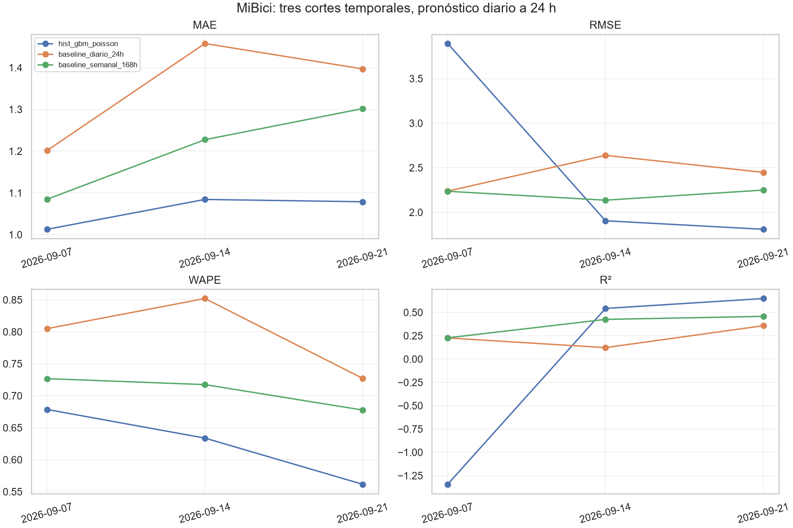
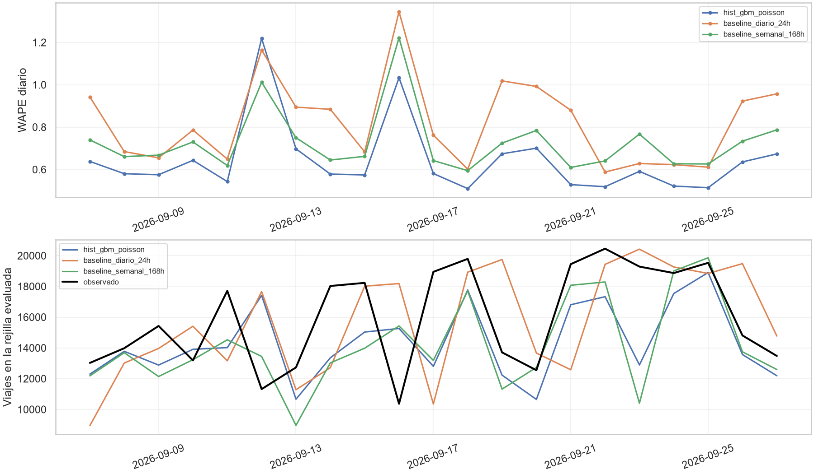

# Fase 3: preparación reproducible y validación temporal

Estado: **EJECUTADO**. Ejecución `20261119T195229_3cc516c1`. Python 3.13.0; rama `fase3`.

## Datos y reproducción

Se descargaron/verificaron solo los meses necesarios (agosto y septiembre de 2026 en la configuración predeterminada), desde [MiBici](https://mibici.net/en/open-data/). Cada CSV debe coincidir en tamaño y SHA-256 con `data/raw/manifest.csv` de Fase 1. El manifiesto original no se reescribe. `procedencia_datos.json` contiene URLs, hashes y ventana utilizada; `limpieza.csv`, los conteos por regla. Los datos personales no se conservan en el parquet preparado.

```powershell
.venv\Scripts\python.exe -m mibici_demand.modeling.backtest
# Repetir sin descargar: añadir --sin-descarga
.venv\Scripts\python.exe -m pytest tests -q
.venv\Scripts\python.exe -m mlflow ui --backend-store-uri sqlite:///mlflow_fase3.db
```

Los comandos se ejecutan desde la raíz en la rama `fase3`. Se reutilizan `dataset.download/read_trips`, `TripCleaner`, `features.monthly_tables/get_feature_columns`, `build_model_pipeline` y `compute_metrics`. Datos en `data/raw/fase3` y `data/processed/fase3`; modelos nuevos en `models/fase3/<ejecución>`; MLflow en una base y experimento separados. `versiones.json` fija el entorno y hashes del código (incluye archivos todavía sin commit). No se modifica el campeón ni los resultados de Fases 1/2.

## Metodología y protección temporal

Cada corte entrena un pipeline independiente. El estimador es HistGradientBoostingRegressor con pérdida Poisson, parámetros fijados **antes** de observar estas ventanas, sin búsqueda ni selección del mejor corte. No se cargan pesos ni hiperparámetros optimizados del modelo histórico. Parámetros, semilla, fechas, fuentes y modelos serializados se registran por corte en MLflow.

El entrenamiento abarca 28 días en la configuración predeterminada, con una purga/maduración adicional de 24 horas antes del corte. Así, incluso un viaje válido de la duración máxima permitida (24 h) termina antes de usar su etiqueta. Todas las divisiones son intervalos semiabiertos por timestamps locales completos, nunca por posiciones de filas: `[inicio, fin)`. Las estaciones de una misma hora no se reparten entre entrenamiento y evaluación.

En cada semana se emite un pronóstico a las 00:00 de cada día para sus 24 horas siguientes. El modelo se mantiene fijo durante esa semana; los rezagos se actualizan con observaciones anteriores a cada nueva emisión. Esto es backtesting de pronósticos **diarios**, no un pronóstico único de siete días. Cada `lag_24`/`lag_168` cuenta exclusivamente viajes terminados antes de su origen de pronóstico y de una hora ya cerrada. Los viajes todavía abiertos no se cuentan. No se usan `lag_1` ni `media_24h`. Las etiquetas finales de evaluación solo se usan para puntuar.

El perfil por estación, PCA, imputador, escalador y codificadores se ajustan solo con el entrenamiento del corte. La cohorte se fija con estaciones conocidas, con al menos siete días de historial y actividad durante la semana anterior al corte. Las horas de servicio se aprenden con el entrenamiento (umbral heredado 0.001 de viajes). La cohorte y el horario permanecen fijos al evaluar; no se consultan últimas apariciones ni aperturas futuras. El catálogo actual de capacidad/coordenadas se excluye por carecer de versiones históricas verificables.

## Ventanas ejecutadas

| Corte / inicio evaluación | Inicio train | Fin train exclusivo | Fin evaluación exclusivo | Filas train | Filas evaluación | Estaciones | Cobertura de viajes |
|---|---|---|---|---:|---:|---:|---:|
| 2026-09-07 | 2026-08-09 | 2026-09-06 | 2026-09-14 | 251,480 | 65,240 | 466 | 99.90% |
| 2026-09-14 | 2026-08-16 | 2026-09-13 | 2026-09-21 | 260,440 | 65,240 | 466 | 99.68% |
| 2026-09-21 | 2026-08-23 | 2026-09-20 | 2026-09-28 | 261,020 | 65,520 | 468 | 100.00% |

`cortes.json` conserva timestamps completos, IDs de estaciones, horario y exclusiones por corte. La cobertura es la proporción de viajes reales de la red incluidos en la rejilla, no una medida de precisión.

## Resultados reales

WAPE se expresa como proporción (0.50 equivale a 50%). R² y WAPE se dejan sin valor si no tienen varianza/denominador válidos. Modelo y baselines comparten exactamente las mismas filas.

| Corte | Modelo | MAE | RMSE | WAPE | R² | WAPE pico |
|---|---|---:|---:|---:|---:|---:|
| 2026-09-07 | hist_gbm_poisson | 1.0129 | 3.8942 | 0.6786 | -1.3431 | 0.5963 |
| 2026-09-07 | baseline_diario_24h | 1.2015 | 2.2373 | 0.8050 | 0.2265 | 0.7963 |
| 2026-09-07 | baseline_semanal_168h | 1.0848 | 2.2359 | 0.7268 | 0.2275 | 0.6784 |
| 2026-09-14 | hist_gbm_poisson | 1.0843 | 1.9051 | 0.6338 | 0.5429 | 0.6078 |
| 2026-09-14 | baseline_diario_24h | 1.4577 | 2.6393 | 0.8520 | 0.1226 | 0.8469 |
| 2026-09-14 | baseline_semanal_168h | 1.2274 | 2.1360 | 0.7174 | 0.4253 | 0.6961 |
| 2026-09-21 | hist_gbm_poisson | 1.0788 | 1.8094 | 0.5615 | 0.6492 | 0.5103 |
| 2026-09-21 | baseline_diario_24h | 1.3969 | 2.4481 | 0.7271 | 0.3578 | 0.6698 |
| 2026-09-21 | baseline_semanal_168h | 1.3019 | 2.2496 | 0.6777 | 0.4577 | 0.6244 |

### Comparación conjunta de las tres semanas

Las métricas conjuntas se recalculan concatenando todas las predicciones; no son un promedio simple de WAPE o R².

| Modelo | MAE | RMSE | WAPE | R² |
|---|---:|---:|---:|---:|
| hist_gbm_poisson | 1.0587 | 2.7111 | 0.6196 | 0.0751 |
| baseline_diario_24h | 1.3521 | 2.4471 | 0.7914 | 0.2465 |
| baseline_semanal_168h | 1.2048 | 2.2078 | 0.7052 | 0.3866 |

### Cambio al avanzar el corte

- 2026-09-07: WAPE del modelo 0.6786; mejor baseline `baseline_semanal_168h` (0.7268); mejora relativa 6.6327% (negativa significa empeoramiento).
- 2026-09-14: WAPE del modelo 0.6338; mejor baseline `baseline_semanal_168h` (0.7174); mejora relativa 11.6579% (negativa significa empeoramiento).
- 2026-09-21: WAPE del modelo 0.5615; mejor baseline `baseline_semanal_168h` (0.6777); mejora relativa 17.1352% (negativa significa empeoramiento).

### Errores grandes y lectura del resultado

Mejorar MAE/WAPE no garantiza mejorar RMSE/R². Se conservan todas las predicciones, sin descartar casos difíciles ni limitar sus valores después de observar los resultados. `errores_mayores.csv` muestra los veinte errores absolutos más grandes de cada corte.

- En 2026-09-07, el RMSE del modelo (3.8942) supera al semanal (2.2359); R² del modelo: -1.3431. Este resultado desfavorable impide afirmar que el modelo domina todas las métricas.
- Mayor error observado: estación 46, hora 2026-09-12 21:00:00; observado 0, predicción 438.0117, lag diario 0 y semanal 50. Es un diagnóstico descriptivo; no se atribuye una causa única ni se ajustan hiperparámetros usando estas semanas.





## Trazabilidad y observaciones del profesor

Experimento MLflow: `mibici-fase3-validacion-temporal`. Corrida padre: `abec722ef1944742a550de4c1ff7a385`. `ejecucion.json` enlaza los tres runs hijos y los modelos; se registran MAE, RMSE, WAPE, R² y métricas pico de los tres predictores, firmas de entrada y datasets de entrenamiento/evaluación.

Se atendió la solicitud de **avanzar los cortes y comparar resultados** con tres reentrenamientos cronológicos y tres semanas posteriores distintas. Se añadió la comparación diaria/semanal sobre las mismas observaciones y controles automáticos de timestamps, maduración de etiquetas, disponibilidad de rezagos y preprocesamiento. La evidencia es ejecutada sobre CSV reales, sin trasladar las cifras históricas de Fase 2 a estas ventanas.

## Limitaciones y pendientes

- Los CSV se publican mensualmente. La disponibilidad diaria de viajes terminados se **simula offline**; esta fuente pública por sí sola no permite operar un servicio diario en tiempo real. Hace falta un feed operativo con disponibilidad equivalente para desplegarlo.
- Solo se estudian tres semanas de septiembre de 2026 y una ventana corta de entrenamiento por memoria/alcance. No demuestra estabilidad anual, causalidad de los cambios ni significancia estadística; no se calculan intervalos de confianza.
- La familia de modelo se eligió por la experiencia de Fase 2. Aunque cada ajuste usa solo el pasado y aquí no se optimizan hiperparámetros con las ventanas evaluadas, estas semanas no constituyen un holdout totalmente ajeno al trabajo histórico. Una evaluación prospectiva posterior requiere datos no usados en la selección previa.
- Estaciones nuevas o sin suficiente historial se excluyen de la cohorte congelada; la cobertura y los IDs excluidos están documentados. No hay un calendario externo verificado de aperturas/cierres; un cero posterior puede reflejar falta de demanda o una interrupción de servicio.
- Los conteos de rezagos pueden ser provisionales por viajes aún abiertos; las etiquetas evaluadas están finalizadas. No se supone que sus valores sean idénticos a los rezagos de la tabla histórica.
- Las cifras no se comparan directamente con Fase 2: cambian ventanas, datos, cohorte, disponibilidad de variables e hiperparámetros. No se promociona ningún nuevo campeón.
- FastAPI, Docker y drift quedan fuera de este bloque. Tampoco se ha verificado todavía ejecución Linux.
