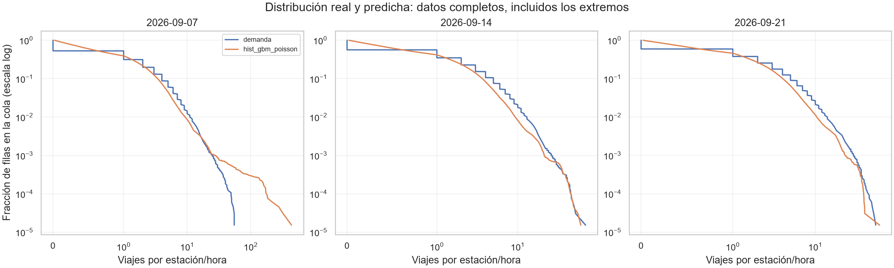
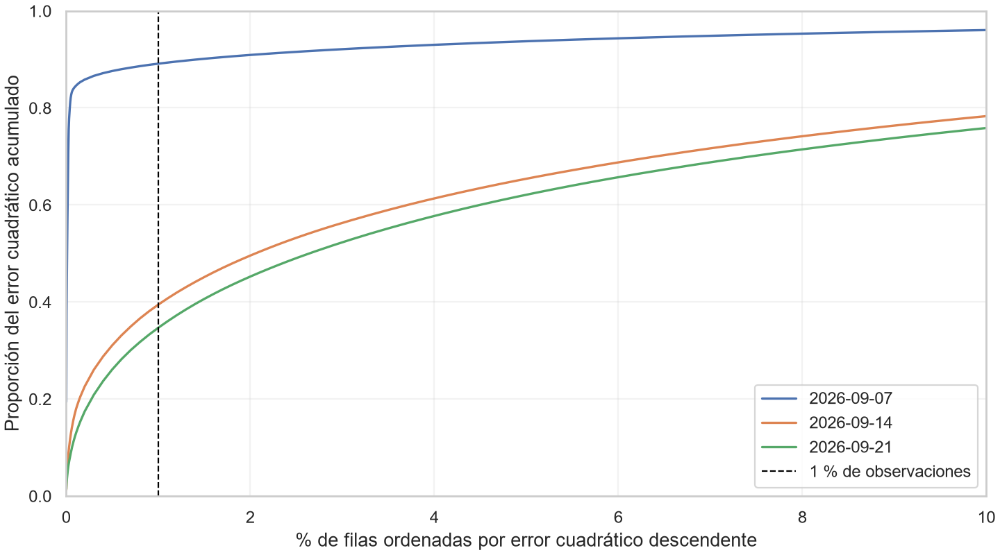
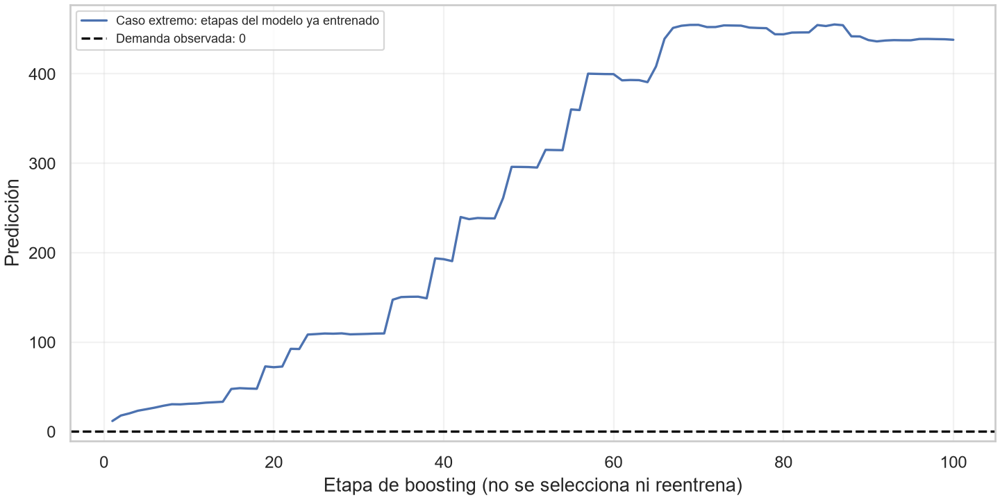

# Auditoría técnica del backtesting MiBici

Ejecutada el 2026-11-19T20:20:55.753211-06:00; rama `fase3`, Python 3.13. Ejecución auditada: `20261119T195229_3cc516c1`.

## Dictamen

No se detectó una discrepancia de implementación en las etiquetas, rezagos, composición de evaluación, alineación de filas, recarga del modelo ni estadísticas del preprocesamiento examinadas. Se conservan las métricas y los modelos originales. No se reentrenó, no se ajustaron hiperparámetros, no se cambió la ventana ni se descartaron observaciones difíciles.

La anomalía es una cola de predicciones extremas del modelo, concentrada en la tarde/noche del 12 de septiembre. La evidencia respalda una combinación poco representada de rezagos semanales altos y perfiles/horarios aprendidos con un episodio previo de demanda alta. La pérdida Poisson con enlace logarítmico permite amplificar la respuesta positiva; no garantiza que las predicciones queden dentro del rango de etiquetas de entrenamiento. La [documentación oficial de scikit-learn](https://scikit-learn.org/stable/modules/generated/sklearn.ensemble.HistGradientBoostingRegressor.html) describe ese enlace. Esto explica un mecanismo compatible con los datos, no identifica la causa operativa del pico de viajes.

## 1. Evidencia preservada y reproducción

Los archivos de la ejecución anterior se copiaron sin reemplazarlos en `auditoria/originales/20261119T195229_3cc516c1/`. Los SHA-256 están en `auditoria/resumen.json`; se comprobó nuevamente que los originales no cambiaron. Los modelos de cada corte siguen en sus rutas originales. La auditoría no modifica el registro de MLflow.

```powershell
.venv\Scripts\python.exe -m mibici_demand.modeling.audit_backtest
.venv\Scripts\python.exe -m pytest tests -q --junitxml=reports/fase3/pytest_auditoria.xml
```

Los CSV de agosto y septiembre se verifican contra sus hashes originales. Se repite la limpieza mediante máscaras explícitas y se reconstruyen etiquetas y rezagos por agrupación independiente, sin llamar a `TripCleaner` ni `features.monthly_tables` para esa comprobación. Después se contrasta la rejilla del constructor con el parquet guardado. Solo se leen datos de agosto/septiembre; octubre no se descarga ni se usa para puntuar o ajustar.

## 2. Veinte errores más grandes del primer corte

Error absoluto = |predicción − observado|; error cuadrático = (predicción − observado)². Todos son del corte 2026-09-07; se muestran los valores completos en `auditoria/top20_primer_corte.csv`.

| Estación | Fecha | Hora | Observado | Predicción | Error absoluto | Error cuadrático |
|---:|---|---|---:|---:|---:|---:|
| 46 | 2026-09-12 | 21:00 | 0 | 438.0117 | 438.0117 | 191854.2868 |
| 46 | 2026-09-12 | 20:00 | 0 | 322.8543 | 322.8543 | 104234.8922 |
| 396 | 2026-09-12 | 21:00 | 4 | 275.6520 | 271.6520 | 73794.7877 |
| 197 | 2026-09-12 | 21:00 | 2 | 217.0247 | 215.0247 | 46235.6367 |
| 196 | 2026-09-12 | 21:00 | 2 | 184.4626 | 182.4626 | 33292.5835 |
| 194 | 2026-09-12 | 21:00 | 3 | 181.3008 | 178.3008 | 31791.1844 |
| 194 | 2026-09-12 | 20:00 | 0 | 172.0668 | 172.0668 | 29606.9676 |
| 54 | 2026-09-12 | 21:00 | 5 | 171.3999 | 166.3999 | 27688.9220 |
| 196 | 2026-09-12 | 20:00 | 4 | 165.6684 | 161.6684 | 26136.6739 |
| 50 | 2026-09-12 | 21:00 | 15 | 172.6531 | 157.6531 | 24854.5137 |
| 50 | 2026-09-12 | 20:00 | 3 | 158.6474 | 155.6474 | 24226.1281 |
| 54 | 2026-09-12 | 20:00 | 6 | 158.9432 | 152.9432 | 23391.6321 |
| 49 | 2026-09-12 | 21:00 | 2 | 154.4298 | 152.4298 | 23234.8325 |
| 49 | 2026-09-12 | 20:00 | 4 | 150.6812 | 146.6812 | 21515.3812 |
| 54 | 2026-09-12 | 22:00 | 4 | 139.4486 | 135.4486 | 18346.3220 |
| 194 | 2026-09-12 | 22:00 | 2 | 137.1604 | 135.1604 | 18268.3331 |
| 50 | 2026-09-12 | 22:00 | 10 | 134.5135 | 124.5135 | 15503.6113 |
| 197 | 2026-09-12 | 20:00 | 0 | 113.7127 | 113.7127 | 12930.5842 |
| 396 | 2026-09-12 | 20:00 | 2 | 92.2263 | 90.2263 | 8140.7833 |
| 51 | 2026-09-12 | 21:00 | 15 | 103.9644 | 88.9644 | 7914.6637 |

## 3. Concentración del error y distribuciones

Para cada predictor y corte se ordenan TODAS las filas por error cuadrático descendente y se toman `ceil(0.01*n)` filas. El denominador sigue siendo el SSE de todas las observaciones. Los empates no alteran la suma porque tienen el mismo error. No es una evaluación recortada ni se presentan métricas sin extremos como sustituto.

| Corte | Filas | Filas top 1 % | SSE total modelo | % SSE top 1 % | % SSE top 20 |
|---|---:|---:|---:|---:|---:|
| 2026-09-07 | 65,240 | 653 | 989326.20 | 89.10% | 77.12% |
| 2026-09-14 | 65,240 | 653 | 236773.40 | 39.42% | 9.80% |
| 2026-09-21 | 65,520 | 656 | 214508.64 | 34.66% | 6.92% |

En el primer corte, el 12 de septiembre aporta el **85.94%** de todo el SSE de la semana. Los veinte casos de la tabla aportan el 77.12%. El RMSE penaliza esos errores al cuadrado y R² = 1 − SSE/SST resulta negativo cuando el SSE supera la variación de las etiquetas. MAE y WAPE penalizan linealmente, por lo que pueden mejorar mientras empeoran RMSE y R².

| Corte | Serie evaluación | Media | P50 | P90 | P99 | P99.9 | Máximo |
|---|---|---:|---:|---:|---:|---:|---:|
| 2026-09-07 | demanda | 1.493 | 1.000 | 4.000 | 11.000 | 25.000 | 55.000 |
| 2026-09-07 | hist_gbm_poisson | 1.456 | 0.698 | 3.423 | 9.289 | 27.220 | 438.012 |
| 2026-09-14 | demanda | 1.711 | 1.000 | 5.000 | 13.000 | 26.000 | 69.000 |
| 2026-09-14 | hist_gbm_poisson | 1.488 | 0.758 | 3.652 | 9.302 | 21.288 | 60.327 |
| 2026-09-21 | demanda | 1.921 | 1.000 | 5.000 | 14.000 | 29.000 | 54.000 |
| 2026-09-21 | hist_gbm_poisson | 1.667 | 0.874 | 4.038 | 10.404 | 22.933 | 60.109 |





Las distribuciones completas de entrenamiento/evaluación, ceros, cuantiles y baselines están en `auditoria/distribuciones.csv`. El máximo observado se conserva como descripción, no como umbral para truncar predicciones.

## 4. Investigación de causas

### Rezagos y episodio de demanda alta

Se comprobaron 196,000 etiquetas y 392,000 rezagos contra conteos independientes de los CSV. No hubo discrepancias. En los veinte errores mayores, la fuente semanal corresponde al 5 de septiembre de 2026 y la diaria al 11; ambas preceden a la emisión del 12 a las 00:00. El CSV de trazabilidad conserva el máximo fin de los viajes usados, conteos crudos/limpios y número de IDs únicos. Un pico real en el registro no demuestra por sí solo un evento externo ni descarta problemas de captura del operador.

| Corte | Variable | Máximo train | P99 train | Máximo evaluación | Filas evaluación > máximo train |
|---|---|---:|---:|---:|---:|
| 2026-09-07 | lag_168 | 59 | 10 | 137 | 10 |
| 2026-09-14 | lag_168 | 137 | 10 | 55 | 0 |
| 2026-09-21 | lag_168 | 137 | 11 | 69 | 0 |

Para la estación 46, el mayor lag semanal en sus filas de train era 24; el caso extremo recibe 50. Hay 0 filas de train del mismo día de semana y hora con un lag semanal al menos tan alto. El modelo no había observado esa combinación con suficiente soporte. El pico del 5 de septiembre entra como etiqueta en el primer entrenamiento, pero su repetición como rezago semanal aparece después; los cortes posteriores sí pueden incorporar las nuevas observaciones anteriores a su corte. Es evidencia compatible con sensibilidad a una señal semanal poco repetible, no una demostración causal controlada.

### Poco historial, imputación y calidad de datos

Los veinte casos tienen entre 27 y 28 días representados en train y entre 540 y 560 filas por estación. Se observaban desde al menos 35.7 días antes del corte dentro de la ventana descargada. No corresponden a estaciones nuevas sin perfil. Esto no equivale a conocer su fecha real de apertura.

En los tres cortes hubo cero nulos de entrada, cero valores numéricos que requirieran imputación en evaluación y cero estaciones sin perfil. Las medias por estación, medianas del imputador y medias del escalador guardados coinciden con train; se preserva el orden de las filas. `auditoria/preprocesamiento.csv` documenta las comprobaciones. No se identificó imputación ni desalineación como causa de estos extremos.

No faltan archivos o días de toda la red en la ventana preparada, sus hashes coinciden y la lectura de fechas no produjo fechas nulas. La reconstrucción explícita de la limpieza produce los mismos conteos que el parquet preparado. Un cero estación/hora representa ausencia de viajes registrados tras limpieza; sin bitácoras del operador no se distingue concluyentemente demanda nula, cierre temporal o pérdida de captura. No se inventan viajes para rellenarlo.

### Amplificación de predicciones

Con el modelo guardado, sin llamar a `fit`, se recorrieron sus cien etapas mediante `staged_predict`. Todas se conservan: no se escoge retrospectivamente una etapa más favorable. Se hicieron además dos perturbaciones diagnósticas del lag semanal, sustituyéndolo por la mediana y P99 del TRAIN, dejando el resto igual. Estas cifras describen sensibilidad; no son pronósticos válidos alternativos ni métricas de una nueva evaluación.

| Escenario diagnóstico | lag_168 | Predicción del caso extremo |
|---|---:|---:|
| original | 50 | 438.0117 |
| mediana_train | 1 | 25.7578 |
| p99_train | 10 | 90.9250 |



La sensibilidad al rezago explica parte de la amplificación, pero aun con un lag de referencia persiste una predicción alta. Los efectos de perfil de estación, calendario y otros rezagos interactúan; este diagnóstico no separa causalmente sus contribuciones. Las perturbaciones de valor conservan exactamente los tipos originales y el escenario original reproduce la predicción guardada.

### Sensibilidad a la precisión numérica: requisito para servir el modelo

Se comparó además el mismo caso con los mismos valores de entrada y otra precisión para los rezagos. Es un diagnóstico independiente del anterior. La salida del escalado puede redondearse de forma diferente y atravesar umbrales de árboles. La observación evidencia sensibilidad a la representación; no prueba un defecto de la biblioteca ni una corrección de los errores extremos.

| Representación de los rezagos | Predicción del mismo caso |
|---|---:|
| float32_original | 438.0117 |
| float64_mismos_valores | 342.0500 |

El backtesting original usa lag_24/lag_168 en float32 y se reproduce íntegramente con ese contrato. No se cambian las métricas por las de float64. En la futura API habrá que reconstruir explícitamente los mismos tipos y probar igualdad contra el pipeline offline; aceptar JSON y dejar que pandas infiera float64 no garantiza equivalencia. Esta fragilidad debe quedar documentada y comprobada durante FastAPI/Docker.

## 5. Disponibilidad y composición del conjunto

- El corte fija la cohorte usando solo viajes finalizados antes de él, actividad de la semana anterior y siete días mínimos de historial. El horario se aprende con los 28 días de etiquetas de entrenamiento. La auditoría reconstruye ambos sin leer etiquetas futuras y compara la rejilla estación × timestamp con todas las filas guardadas.
- La cohorte y horario quedan congelados durante cada semana. Esto es una decisión conservadora conocida al emitir cada día, no una selección basada en demanda futura. No incorpora aperturas de estaciones durante la semana; la cobertura original sigue documentada.
- En cada emisión diaria solo entran viajes con fin estrictamente anterior al origen y horas fuente ya cerradas. Se reconstruyeron los lags para los 21 orígenes; no basta que el nombre de la columna diga lag. Las observaciones de los días evaluados anteriores pueden usarse al día siguiente porque el protocolo es rolling-origin diario, no un pronóstico único semanal.
- El calendario objetivo se conoce de antemano. No se usan lag_1, media_24h, catálogo actual ni etiquetas de evaluación como variables. El pipeline histórico no se usa para estas predicciones.
- La maduración de etiquetas es de 24 horas, coherente con la duración máxima de limpieza. Los timestamps de entrenamiento y evaluación son intervalos semiabiertos completos y no dividen estaciones de una misma hora por posiciones de fila.
- Los CSV son mensuales: la disponibilidad intradiaria es una simulación retrospectiva de telemetría de viajes terminados. No demuestra que el portal público hubiera entregado la información a las 00:00 de cada fecha.

## 6. Comparación completa sobre las mismas observaciones

Cada fila del parquet incluye simultáneamente observado, modelo y ambos baselines. No se aplicaron máscaras distintas ni se omitieron extremos. MAE y RMSE son viajes/estación/hora; WAPE es proporción.

| Corte | Predictor | N | MAE | RMSE | WAPE | R² |
|---|---|---:|---:|---:|---:|---:|
| 2026-09-07 | hist_gbm_poisson | 65,240 | 1.0129 | 3.8942 | 0.6786 | -1.3431 |
| 2026-09-07 | baseline_diario_24h | 65,240 | 1.2015 | 2.2373 | 0.8050 | 0.2265 |
| 2026-09-07 | baseline_semanal_168h | 65,240 | 1.0848 | 2.2359 | 0.7268 | 0.2275 |
| 2026-09-14 | hist_gbm_poisson | 65,240 | 1.0843 | 1.9051 | 0.6338 | 0.5429 |
| 2026-09-14 | baseline_diario_24h | 65,240 | 1.4577 | 2.6393 | 0.8520 | 0.1226 |
| 2026-09-14 | baseline_semanal_168h | 65,240 | 1.2274 | 2.1360 | 0.7174 | 0.4253 |
| 2026-09-21 | hist_gbm_poisson | 65,520 | 1.0788 | 1.8094 | 0.5615 | 0.6492 |
| 2026-09-21 | baseline_diario_24h | 65,520 | 1.3969 | 2.4481 | 0.7271 | 0.3578 |
| 2026-09-21 | baseline_semanal_168h | 65,520 | 1.3019 | 2.2496 | 0.6777 | 0.4577 |

La auditoría reprodujo las nueve combinaciones predictor/corte con tolerancia 1e-12 frente al reporte original. El modelo mejora MAE/WAPE en las tres ventanas, pero el primer corte empeora RMSE y R² frente a ambos baselines. No se declara dominio general ni aceptación productiva del modelo.

## 7. Veintiocho días frente a seis meses

La elección de 28 días fue una decisión previa de alcance computacional y descarga: permite cuatro ciclos semanales y cubrir los tres cortes con solo dos CSV mensuales. No se realizó un estudio empírico previo que demuestre que 28 días sean mejores o suficientes frente a seis meses. Tampoco se midió una limitación de memoria que impidiera seis meses; Fase 2 ya había podido entrenar con aproximadamente 1.56 millones de filas. Por tanto, **la ventana corta es una limitación metodológica**, no un óptimo validado ni una necesidad técnica demostrada.

Los cortes actuales usan aproximadamente 251–261 mil filas y menos repeticiones de episodios raros. La falta de soporte en rezagos altos es compatible con esa limitación, pero no demuestra que seis meses resolverían el problema. No se entrena otra ventana sobre estas semanas para escoger retrospectivamente la que produzca mejores métricas. Una comparación futura requeriría validación interna temporal, íntegramente anterior a cada corte y con presupuesto/criterios predeclarados; después, un test no examinado. Se mantuvieron tanto la ventana de 28 días como los parámetros originales.

## 8. ¿Octubre de 2026 puede reservarse como prueba final?

**No se puede certificar como holdout virgen del proyecto con la evidencia disponible.** Fase 3 solo usó agosto y septiembre y no ha leído ni evaluado viajes de octubre. Sin embargo, al inspeccionar el artefacto histórico se encontraron las categorías de mes aprendidas `[4, 5, 6, 7, 8, 9, 10]`, incluida 10. El manifiesto original también contiene el CSV de octubre de 2026.

El codificador del artefacto usa categories='auto': el mes 10 fue aprendido, no solo declarado como categoría posible. Es evidencia de un octubre usado en el ajuste del artefacto histórico; el codificador no almacena el año, así que por sí solo no prueba que fuera octubre de 2026. El manifiesto acredita disponibilidad, no uso en entrenamiento. Faltan los timestamps/datasets originales para excluir ese uso de manera defendible. Los documentos previos no resuelven esa trazabilidad. Por eso sería incorrecto afirmar ahora que octubre de 2026 nunca influyó en decisiones previas del proyecto.

Se mantiene octubre sin consumir en este bloque y se registra el estado en `auditoria/reserva_octubre2026.json`. Podría ser un test externo para el procedimiento de Fase 3, declarando sus antecedentes, pero no un test ciego de todo el desarrollo sin resolver la trazabilidad. Para máxima limpieza académica: recuperar evidencia del periodo usado por el histórico o reservar un periodo completo verdaderamente no examinado, con código, ventana, parámetros y criterios de aceptación congelados antes de observar resultados. Aquí no se entrena con octubre ni se usa para seleccionar nada.

## 9. Pruebas y recomendaciones

Última ejecución de la suite: **53 pruebas**, 0 fallos, 0 errores y 0 omitidas; 53.23 s. Evidencia: `pytest_auditoria.xml`. Las nuevas pruebas verifican la selección del 1 %, detección de rezagos/etiquetas adulterados, límites de disponibilidad y cambios ilícitos de cohorte.

El bloque de evaluación es defendible como experimento offline acotado y reproducible; no se detectó un error que justifique reentrenar o sustituir las métricas. Puede avanzar a una API y empaquetado para revisión técnica, conservando este resultado negativo. **No está acreditada la fiabilidad para decisiones operativas reales**: requiere analizar episodios atípicos con el operador, más periodos no examinados, un contrato de disponibilidad de datos y criterios de aceptación prospectivos. No se añade ahora un recorte de predicciones ni otra regla escogida para mejorar estas semanas.

Recomendaciones: preservar los baselines como referencias operativas; investigar la señal semanal excepcional sin atribuirle un evento no confirmado; predeclarar cualquier futura regularización/ventana en validación interna; resolver la reserva de octubre; mantener explícita la diferencia entre éxito de ejecución y calidad predictiva. FastAPI, Docker y drift no se implementan en esta auditoría.
