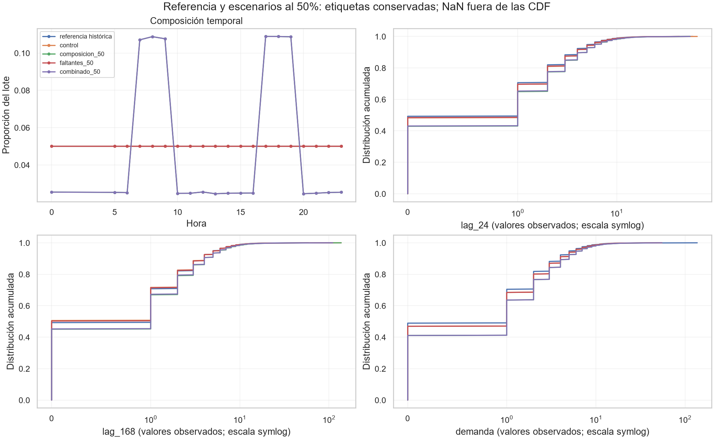
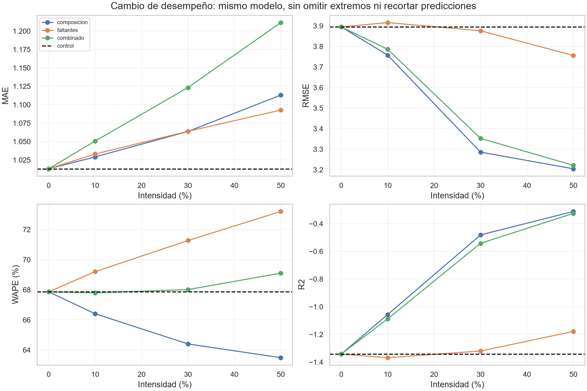
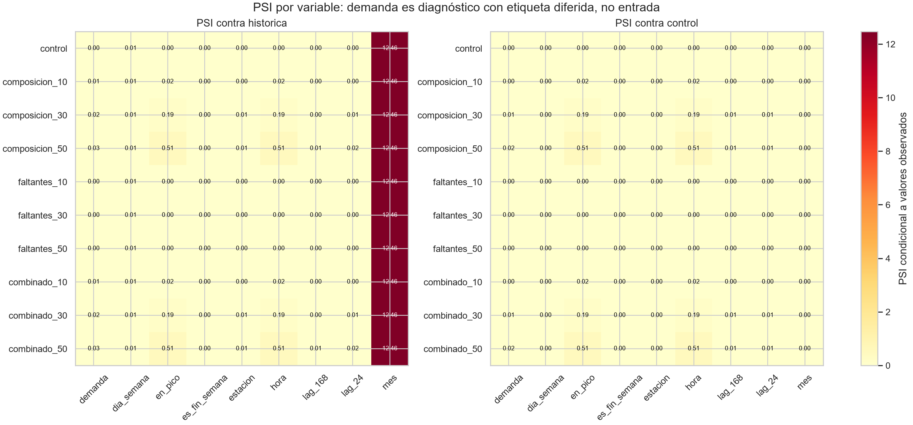
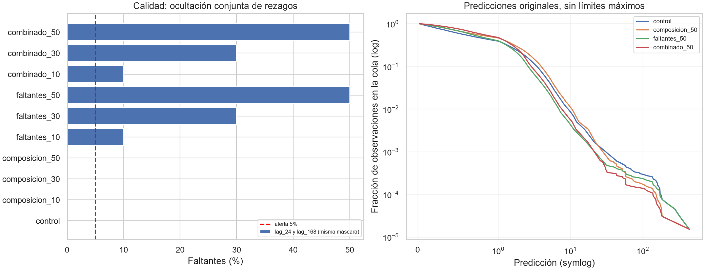

# Fase 3: simulación ejecutada de Data Drift y desempeño

Estado: **EJECUTADO**. Fecha UTC: `2026-11-21T01:38:31.452684+00:00`. Rama `fase3`; Python 3.13.0. No se entrenó ni reemplazó ningún modelo.

## Datos y modelo fijo

Se eligió el **primer corte cronológico**, sin seleccionar la semana por sus resultados. El comportamiento anómalo de ese corte ya era conocido; este experimento no es una nueva validación ciega. No se usa `models/best_pipeline.joblib` porque su periodo de entrenamiento no acredita ausencia de información posterior.

Se carga `models/fase3/20261119T195229_3cc516c1/pipeline_20260907.joblib` del backtesting `20261119T195229_3cc516c1` (run MLflow de origen `62196d4e740440e78fe3252757782cb3`). Su SHA-256 es `356a20f59e4b72202faf5a40986e0282aadcc05840f070a367527c74a47513a0`. Se conserva el mismo objeto, pesos, perfil de estación, PCA, imputador, escalador y codificadores en todos los escenarios. El hash del estado antes/después coincide: `c995f2190d07643ba48c2ac8bd503c04`.

| Conjunto | Periodo local semiabierto | Filas | Uso |
|---|---|---:|---|
| Referencia histórica | [2026-08-09 00:00:00, 2026-09-06 00:00:00) | 251,480 | Distribuciones de entrenamiento; no se publican métricas in-sample |
| Control etiquetado | [2026-09-07 00:00:00, 2026-09-14 00:00:00) | 65,240 | Métricas y base íntegra de simulación |

Zona `America/Mexico_City`; cohorte fija de 466 estaciones y 20 horas de servicio por día, determinada solo con el pasado del corte. El número de estaciones con historia puede variar dentro del entrenamiento, según la elegibilidad causal heredada; no se fuerza una referencia balanceada retrospectivamente. Las fechas son locales sin tz, conforme a los CSV originales.

Las fuentes son los CSV abiertos de MiBici de agosto/septiembre de 2026, limpiados anteriormente con `TripCleaner`. Se reutiliza `data/processed/fase3/viajes_limpios.parquet`, verificando su hash de la ejecución original, y `build_fold` reconstruye la referencia/control; se exige coincidencia exacta con el parquet de backtesting antes de simular. La procedencia completa y hashes están en `drift/ejecucion.json`. No se vuelve a descargar ni limpiar ni se lee octubre. El parquet original tiene datos hasta el 28 de septiembre, pero la lectura para esta simulación filtra comienzos anteriores al 14; su hash completo solo verifica integridad.

## Disponibilidad temporal y etiquetas

El modelo se ajustó antes del corte `2026-09-07 00:00:00` con 28 días, fin exclusivo `2026-09-06 00:00:00` y purga de 24 h. Último fin de viaje de las etiquetas de entrenamiento: `2026-09-06 11:12:37`. Se reutiliza `verify_composition` y la reconstrucción independiente `verify_labels_and_lags` sobre referencia y monitoreo: **cero discrepancias**. No se vuelve a llamar a `fit`.

Cada origen es la medianoche del día objetivo; `lag_24` y `lag_168` solo cuentan viajes terminados antes de ese origen y de horas cerradas. Calendario, cohorte y horario no se determinan con etiquetas futuras. No se usan `lag_1`, medias del día objetivo, metadatos actuales ni el campeón histórico. Cada escenario conserva los timestamps de origen/fuentes de sus registros. La selección de horas pico consulta solo `hora` y RNG, nunca demanda.

Las etiquetas finales se utilizan **solo después de observarlas** para medir desempeño offline. Se declara disponibilidad conservadora del lote completo desde `2026-09-15 00:00:00` (24 h después del fin exclusivo); máximo fin de viaje leído `2026-09-14 00:33:34`. Los CSV públicos mensuales no constituyen un feed diario real: la disponibilidad operativa se simula, como en el backtesting. Octubre sigue sin consumirse y se conserva la salvedad previa sobre su trazabilidad histórica.

Tipos originales de entrada: `estacion: int64`, `hora: int8`, `dia_semana: int8`, `mes: int8`, `es_fin_semana: int8`, `lag_24: float32`, `lag_168: float32`. Se verifica que el muestreo y NaN no cambien esos tipos; en particular los rezagos permanecen float32 y las predicciones float64.

## Plan fijado antes de puntuar

`references/plan_drift.json` fue guardado a `2026-11-21T01:25:16Z` antes de ejecutar esta simulación; SHA-256 `995dee59f49e526f3a2d5eeb0b746126dbffe24c3dbe72a12b014c699e6aaf4d`. Se copia a `drift/plan_predeclarado.json` antes de cargar datos. No se ajustaron umbrales ni intensidades tras observar resultados. El backtesting previo ya era conocido; esto no supone calibración prospectiva de alertas.

- **A. Control:** todas las observaciones, sin modificación. Se recalculan las predicciones y se comparan con las anteriores.
- **B. Composición:** se sustituye `floor(a*N_no_pico)` posiciones no pico por filas pico completas muestreadas con reemplazo. Horas pico heredadas: 7, 8, 9, 17, 18 y 19. La fracción pico resultante es `p + floor(a*N_no_pico)/N`; no se confunde la intensidad con el porcentaje final de horas pico.
- **C. Faltantes:** se ocultan **ambos** rezagos en `floor(a*N)` posiciones elegidas sin consultar X o y (MCAR en la población de solicitudes). Simula una interrupción conjunta de disponibilidad del feature store; el fenómeno físico y su demanda no se alteran. Solo se sustituye el valor recibido por NaN.
- **D. Progresivo:** B y C se ejecutan por separado al 10%, 30% y 50%; además se combina composición seguida de faltantes a esas tres intensidades. El combinado no identifica por sí solo qué mecanismo causa el cambio.

Semilla 42 para composición y 43 para faltantes, con `numpy.random.default_rng`; sustituciones/máscaras anidadas entre intensidades. Se mantiene el tamaño del lote. `fila_fuente` enlaza cada fila con el control original y `posicion_lote` identifica cada solicitud simulada. Se comprueba igualdad exacta de todas las columnas con su fila fuente, permitiendo únicamente NaN en rezagos en C/D. El muestreo tiene duplicados: no crea viajes nuevos ni nuevas observaciones independientes. Es una mezcla de solicitudes, no una nueva serie de viajes; no se recalculan rezagos a partir del lote remuestreado.

## Detectores y umbrales

PSI = Σ(qᵢ−pᵢ)·ln(qᵢ/pᵢ). Para rezagos/demanda se fijan cuantiles de la referencia (deciles, eliminando cortes repetidos), límites de soporte y colas. Para calendario/estación se fijan categorías históricas y una categoría desconocida. No se redefine el binning con monitoreo, ni siquiera al comparar un escenario con control. Se suma 1e-6 a cada probabilidad y se renormaliza para manejar bins vacíos. `bins_referencia.json` y `distribuciones_bins.csv` permiten auditar los cálculos.

El PSI es **condicional a valores observados**: NaN se mide aparte para no llamar cambio de demanda a un fallo de captura. Se informa PSI contra entrenamiento y contra control para separar cambio natural de la semana y perturbación añadida. Se complementa con distancia TV discretizada y distancia empírica KS para numéricas; no se usan p-valores ni se afirma significación, porque hay conteos discretos, dependencia estación/tiempo y duplicados. Las hipótesis de la [prueba KS de SciPy](https://docs.scipy.org/doc/scipy/reference/generated/scipy.stats.ks_2samp.html) no se cumplen como prueba IID en este diseño. La literatura primaria [Haas y Sibbald, 2024](https://journals.sagepub.com/doi/10.3233/DS-240059) también advierte que los puntos de corte de estabilidad deben depender del caso de uso.

| Señal | Vigilancia / alerta predeclarada | Acción propuesta |
|---|---|---|
| Distribución de entrada | PSI ≥0.10 / ≥0.25 | Revisar calendario y mezcla; segmentar y monitorizar; no inferir degradación por PSI |
| Calidad de rezagos | Faltantes ≥1% / ≥5% | Investigar captura/feature store; corregir causa y recuperar valores |
| Pérdida MAE | Aumento ≥10% y ≥0.05 viajes | Revisar errores/segmentos y causas de datos |
| Pérdida RMSE | Aumento ≥10% y ≥0.10 viajes | Investigar errores extremos sin suprimirlos |
| Pérdida WAPE | Aumento ≥10% y ≥0.02 (2 puntos porcentuales) | Revisar precisión relativa al volumen |
| Pérdida R² | Descenso ≥0.10 unidades | Revisar junto con errores y varianza de y |

Son reglas **ilustrativas de ingeniería**, sin calibración de falsos positivos ni aprobación operativa, no conclusiones estadísticas ni SLO. Los mínimos absolutos evitan alertar solo por cambios diminutos relativos. Si el control tiene error cero, se usa únicamente el mínimo absoluto (el cambio relativo no está definido). La demanda se compara como diagnóstico diferido; no activa una alerta de drift de entradas. Una alerta solo propone investigar/monitorizar/revisar el modelo y evaluar un eventual reentrenamiento con nueva validación temporal; aquí no se ejecuta ninguno ni se cambia el artefacto desplegado.

## Resultados ejecutados

Diferencia máxima control frente al backtesting original: **0**, tolerancia 1e-12. Se mantienen predicciones extremas y todas las filas; no se recorta, elimina ni ajusta ninguna para favorecer resultados. MAE/RMSE en viajes/estación/hora, WAPE como proporción, R² puede ser negativo.

| Escenario | N únicos fuente / N lote | Pico | Faltantes por lag | MAE | RMSE | WAPE | R² |
|---|---:|---:|---:|---:|---:|---:|---:|
| control | 65,240 / 65,240 | 30.00% | 0% | 1.0129 | 3.8942 | 0.6786 | -1.3431 |
| composicion_10 | 60,674 / 65,240 | 37.00% | 0% | 1.0290 | 3.7571 | 0.6640 | -1.0570 |
| composicion_30 | 51,540 / 65,240 | 51.00% | 0% | 1.0635 | 3.2854 | 0.6440 | -0.4817 |
| composicion_50 | 42,406 / 65,240 | 65.00% | 0% | 1.1129 | 3.2043 | 0.6348 | -0.3123 |
| faltantes_10 | 65,240 / 65,240 | 30.00% | 10% | 1.0329 | 3.9155 | 0.6920 | -1.3688 |
| faltantes_30 | 65,240 / 65,240 | 30.00% | 30% | 1.0638 | 3.8758 | 0.7127 | -1.3211 |
| faltantes_50 | 65,240 / 65,240 | 30.00% | 50% | 1.0926 | 3.7554 | 0.7319 | -1.1792 |
| combinado_10 | 60,674 / 65,240 | 37.00% | 10% | 1.0505 | 3.7857 | 0.6779 | -1.0885 |
| combinado_30 | 51,540 / 65,240 | 51.00% | 30% | 1.1231 | 3.3522 | 0.6801 | -0.5426 |
| combinado_50 | 42,406 / 65,240 | 65.00% | 50% | 1.2114 | 3.2211 | 0.6910 | -0.3261 |

| Escenario | Δ MAE | Δ RMSE | Δ WAPE (pp) | Δ R² | Δ MAE relativo | Δ RMSE relativo |
|---|---:|---:|---:|---:|---:|---:|
| control | +0.0000 | +0.0000 | +0.00 | +0.0000 | +0.00% | +0.00% |
| composicion_10 | +0.0161 | -0.1371 | -1.45 | +0.2861 | +1.59% | -3.52% |
| composicion_30 | +0.0507 | -0.6087 | -3.46 | +0.8614 | +5.00% | -15.63% |
| composicion_50 | +0.1001 | -0.6898 | -4.37 | +1.0308 | +9.88% | -17.71% |
| faltantes_10 | +0.0200 | +0.0213 | +1.34 | -0.0257 | +1.98% | +0.55% |
| faltantes_30 | +0.0509 | -0.0184 | +3.41 | +0.0221 | +5.03% | -0.47% |
| faltantes_50 | +0.0797 | -0.1387 | +5.34 | +0.1639 | +7.87% | -3.56% |
| combinado_10 | +0.0376 | -0.1084 | -0.06 | +0.2546 | +3.72% | -2.78% |
| combinado_30 | +0.1103 | -0.5420 | +0.15 | +0.8006 | +10.89% | -13.92% |
| combinado_50 | +0.1985 | -0.6730 | +1.24 | +1.0170 | +19.60% | -17.28% |

Δ = escenario − control. `metricas_escenarios.csv` conserva valores completos, diferencia con signo, diferencia absoluta (magnitud) y relativa de las cuatro métricas; el denominador relativo es |control|, y cero/indefinidos se dejan NA. El porcentaje de cambio de un R² negativo no es una mejora porcentual interpretable; la alerta usa caída en unidades. WAPE/R² se dejan NA si falta denominador/varianza.

## Distribuciones, calidad y alertas observadas

| Escenario | Drift vs historia | Drift añadido vs control | Calidad | Pérdida de desempeño | Métricas que activan pérdida |
|---|---|---|---|---|---|
| control | sí | no | no | no | ninguna |
| composicion_10 | sí | no | no | no | ninguna |
| composicion_30 | sí | sí | no | no | ninguna |
| composicion_50 | sí | sí | no | no | ninguna |
| faltantes_10 | sí | no | sí | no | ninguna |
| faltantes_30 | sí | no | sí | no | ninguna |
| faltantes_50 | sí | no | sí | no | ninguna |
| combinado_10 | sí | no | sí | no | ninguna |
| combinado_30 | sí | sí | sí | sí | mae |
| combinado_50 | sí | sí | sí | sí | mae |

Resumen PSI/KS de entradas y máximos (valores completos por variable/comparación en `detectores_drift.csv`):

| Escenario | PSI máximo vs historia (entrada) | PSI máximo vs control (entrada) | KS lag_24 vs control | KS lag_168 vs control | Predicción máxima | SSE del 1% peor |
|---|---:|---:|---:|---:|---:|---:|
| control | 12.4618 | 0.0000 | 0.0000 | 0.0000 | 438.0117 | 89.10% |
| composicion_10 | 12.4618 | 0.0221 | 0.0111 | 0.0102 | 438.0117 | 87.81% |
| composicion_30 | 12.4618 | 0.1864 | 0.0328 | 0.0335 | 438.0117 | 82.66% |
| composicion_50 | 12.4618 | 0.5133 | 0.0532 | 0.0551 | 438.0117 | 80.14% |
| faltantes_10 | 12.4618 | 0.0000 | 0.0002 | 0.0003 | 438.0117 | 88.79% |
| faltantes_30 | 12.4618 | 0.0000 | 0.0003 | 0.0008 | 438.0117 | 87.71% |
| faltantes_50 | 12.4618 | 0.0001 | 0.0010 | 0.0037 | 438.0117 | 85.87% |
| combinado_10 | 12.4618 | 0.0221 | 0.0112 | 0.0104 | 438.0117 | 87.49% |
| combinado_30 | 12.4618 | 0.1864 | 0.0329 | 0.0345 | 438.0117 | 81.12% |
| combinado_50 | 12.4618 | 0.5133 | 0.0524 | 0.0544 | 438.0117 | 75.50% |

El control puede activar drift histórico, por ejemplo por el cambio calendario agosto→septiembre, aunque contra sí mismo tiene PSI cero y ninguna pérdida respecto a sí mismo. Esa alerta natural no significa automáticamente avería ni degradación del modelo. Las alertas de `alertas_acciones.csv` separan tipo, comparación, severidad, valor y acción.

- **composicion, 50%:** MAE cambia +9.88%, RMSE -17.71%, WAPE -4.37 pp y R² +1.0308. Pérdida según reglas: no. No se presupone monotonicidad; se conservan todas las intensidades.
- **faltantes, 50%:** MAE cambia +7.87%, RMSE -3.56%, WAPE +5.34 pp y R² +0.1639. Pérdida según reglas: no. No se presupone monotonicidad; se conservan todas las intensidades.
- **combinado, 50%:** MAE cambia +19.60%, RMSE -17.28%, WAPE +1.24 pp y R² +1.0170. Pérdida según reglas: sí. No se presupone monotonicidad; se conservan todas las intensidades.

La semana control ya tiene RMSE elevado y R² negativo por extremos previamente auditados (incluida estación 46). Si faltantes/remuestreo reducen un extremo, RMSE puede mejorar mientras MAE o WAPE empeoran; eso no convierte datos faltantes en una solución. `errores_mayores.csv` y `sse_top1_proporcion` permiten examinarlo sin eliminar filas. El cambio de composición también altera la distribución de y y su varianza, por lo que R²/WAPE entre mezclas tienen denominadores distintos. Son riesgos sobre cada mezcla de solicitudes, no estimaciones causales del cambio físico de demanda. El fallo de captura sí conserva el mismo y por posición y permite contraste pareado de errores.

Para separar los mecanismos se reutiliza la predicción control de **cada fila fuente** en la mezcla simulada, antes de ocultar rezagos. Todas las filas sin fallo deben conservar esa predicción (tolerancia 1e-12). `descomposicion_errores.csv` descompone el cambio total en efecto mecánico de mezcla y efecto adicional de pérdida de entradas, en MAE y MSE; no se suman diferencias de RMSE porque la raíz no es aditiva. Es una descomposición del experimento, sin inferir efectos sobre demanda física.

| Escenario | Δ MAE por mezcla | Δ MAE adicional por faltantes | Δ MSE por mezcla | Δ MSE adicional por faltantes |
|---|---:|---:|---:|---:|
| control | +0.0000 | +0.0000 | +0.0000 | +0.0000 |
| composicion_10 | +0.0161 | +0.0000 | -1.0488 | +0.0000 |
| composicion_30 | +0.0507 | +0.0000 | -4.3705 | +0.0000 |
| composicion_50 | +0.1001 | +0.0000 | -4.8968 | +0.0000 |
| faltantes_10 | +0.0000 | +0.0200 | +0.0000 | +0.1664 |
| faltantes_30 | +0.0000 | +0.0509 | +0.0000 | -0.1429 |
| faltantes_50 | +0.0000 | +0.0797 | +0.0000 | -1.0610 |
| combinado_10 | +0.0161 | +0.0215 | -1.0488 | +0.2160 |
| combinado_30 | +0.0507 | +0.0596 | -4.3705 | +0.4433 |
| combinado_50 | +0.1001 | +0.0984 | -4.8968 | +0.1079 |









## Reproducción y pruebas

Desde PowerShell en la raíz, rama fase3; usa exclusivamente el entorno existente:

```powershell
& .\.venv\Scripts\python.exe -m mibici_demand.monitoring.drift --threads 4
& .\.venv\Scripts\python.exe -m pytest tests -q --junitxml=reports/fase3/drift/pytest_drift.xml
& .\.venv\Scripts\python.exe -m mibici_demand.monitoring.drift --actualizar-reporte
```

No se instalan dependencias nuevas: NumPy/Pandas/SciPy/Matplotlib/joblib ya están en `.venv`; sus versiones y hashes de código/plan constan en `ejecucion.json`. No requiere un servidor MLflow ni registra/modifica sus corridas anteriores. Para ejecutar también las diez pruebas Docker, mantener Docker Desktop Linux activo y la imagen `mibici-demand:fase3` construida previamente. Las salidas nuevas de este bloque se escriben solo en `reports/fase3/drift/` y este informe; README/documentación y código nuevo se gestionan aparte.

Suite ejecutada: **140 pruebas; 0 fallos, 0 errores y 0 omitidas**; 47.997 s. Evidencia JUnit: `drift/pytest_drift.xml`. Las 107 pruebas anteriores se conservan íntegramente. Las nuevas verifican reproducibilidad/anidación, integridad de etiquetas, disponibilidad temporal, tipos, PSI/KS/categorías, métricas/denominadores, calidad, alertas y uso sin fit.

Se verificaron hashes de 72 artefactos/resultados previos antes y después: todos sin cambios. El artefacto histórico desplegado tampoco se modificó. `predicciones_escenarios.parquet` conserva trazabilidad de cada solicitud simulada, sus etiquetas y predicciones originales.

## Limitaciones y recomendaciones

- Una semana, una semilla y perturbaciones controladas; no hay replicación que estime incertidumbre, potencia o falsas alarmas. La dependencia temporal y los duplicados impiden tratar N como muestras IID. Es una demostración offline reproducible, no validación productiva ni prueba de concept drift P(y|X).
- La referencia de 28 días se hereda sin optimizarla; su suficiencia frente a seis meses sigue sin demostrar. Mes y cambios de cohorte/historia pueden dominar PSI; se deben monitorizar segmentos y calendarios comparables en una futura calibración anterior al periodo de aceptación.
- Las métricas comparan etiquetas completas y no se omiten casos difíciles. En composición la mezcla objetivo cambia; en faltantes se mantiene la misma demanda. No se incrementan rezagos ni demandas con etiquetas incompatibles ni se modifica calendario sin su timestamp.
- **Contrato API:** FastAPI actual rechaza rezagos faltantes/NaN con 422. Este experimento llama directamente al pipeline para estudiar la tolerancia del imputador; no demuestra que esas solicitudes sean aceptadas en producción. En operación deben vigilarse también rechazos, cobertura y latencia, sin abrir silenciosamente el esquema.
- No hay ingestión en vivo, scheduler, alarmas externas, reentrenamiento automático ni sustitución del modelo. Calidad requiere corregir el pipeline de datos; drift sin pérdida requiere investigar/monitorizar; pérdida persistente con datos correctos justifica revisar el modelo y planear reentrenamiento con nueva validación temporal y holdout verdaderamente no examinado.
- No se usan viajes de octubre, no se modifican backtesting/API/Docker y no se publica nada. No se prepara el PDF final. Las alertas y mejoras aparentes no rehabilitan el extremo previamente auditado ni acreditan fiabilidad operativa.
